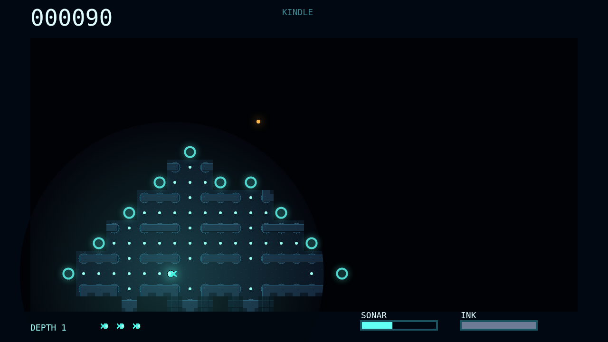

# Fathom

Fathom drops you into a black deep-sea maze with only a small bioluminescent
body to read the corridors around you. Every plankton mote you eat brightens the
glimmerfin, widening both its light and the circular window through which the
remembered maze can be seen.

The dark is not empty. Lanternjaw drifts like a harmless amber jelly until your
light gives you away, Gloamfin listens for sonar and close movement, and
Flarefish turns the whole trench into a sudden burning snapshot before it hunts.
Each predator asks for a different kind of caution.

Sonar is your risky map. A pulse flows through corridors and reveals rock, floor,
and distant bends, but sound can also hand your position to the wrong hunter.
Ink gives you a brief blind spot to slip through when light-hunters close in.

Clearing a depth means grazing every corridor clean, then descending into a
deeper maze with more hunters in the release order. The longer you survive, the
more the trench becomes a memory game played through a breathing circle of light.
